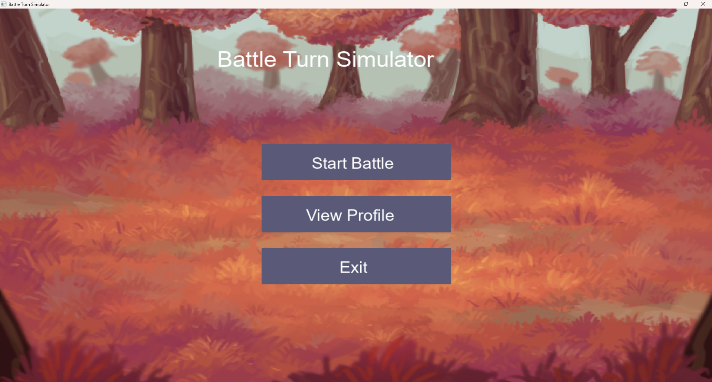
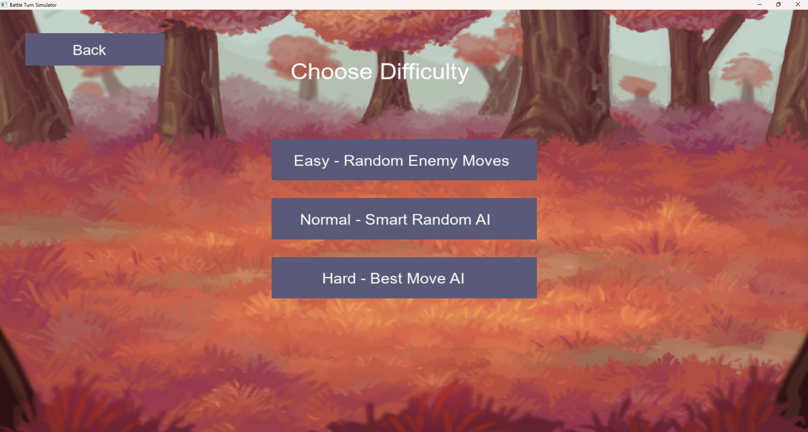
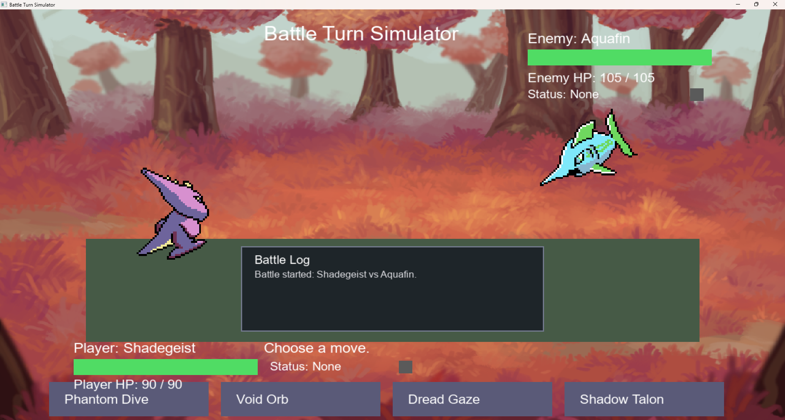
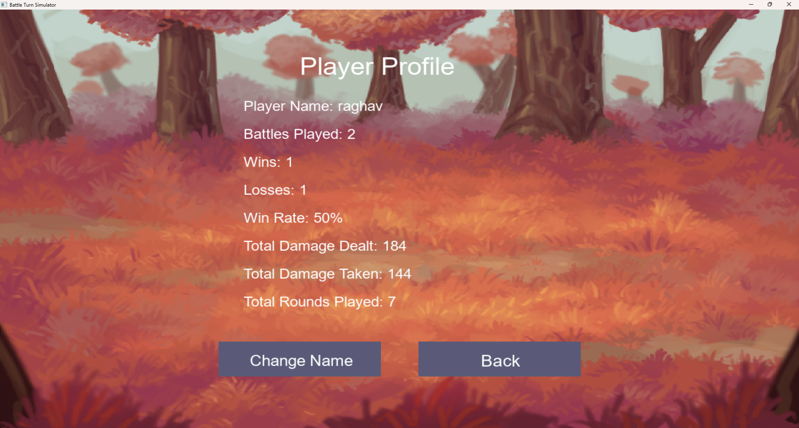

# Battle Turn Simulator

A turn-based creature battle game built in **C++17** with **SFML 3.1**, featuring tactical combat, status effects, multiple AI difficulties, animated attacks, persistent player profiles, battle statistics, sound effects, and a graphical interface.

The project began as a console-based C++ battle engine and was progressively expanded into a modular SFML application with separate systems for gameplay logic, rendering, animations, audio, profiles, saves, and UI utilities.

---

## Features

### Turn-Based Battle System

- Player vs AI creature battles
- Multiple selectable moves per creature
- Move accuracy system
- Randomized damage variation
- Critical hits
- Type effectiveness
- Creature HP and fainting
- Multi-round battles
- End-of-round effects

### Type System

The game currently supports:

- Fire
- Water
- Grass
- Electric
- Normal
- Ghost
- Fighting
- Dragon

Moves use their own type when calculating effectiveness.

Examples include:

- Fire is strong against Grass
- Water is strong against Fire
- Grass is strong against Water
- Electric is strong against Water
- Fighting is strong against Normal
- Dragon is strong against Dragon

---

## Status Effects

Several battle conditions can affect creatures across multiple turns.

### Burn

- Can be applied by certain moves
- Deals status damage over time

### Poison

- Deals damage across multiple rounds

### Sleep

- Can prevent a creature from attacking

### Paralysis

- Can cause a creature to lose its turn

Status effects have their own durations and are processed as part of the battle system.

---

## Original Creature Roster

The game uses an original creature roster.

Current creatures include:

- Voltbit
- Emberling
- Mossback
- Aquafin
- Wildkin
- Shadegeist
- Ironfang
- Skywyrm

Each creature has:

- Its own HP
- A battle type
- A unique move set
- Different move damage values
- Accuracy values
- Status-effect possibilities
- Custom visual assets

---

## AI Difficulty System

Three enemy AI difficulty levels are available.

### Easy

Uses randomized move selection.

### Normal

Uses a smarter randomized strategy.

### Hard

Evaluates available attacks and attempts to select stronger moves based on the current battle situation.

The battle engine separates AI decision-making from the SFML interface, allowing the same underlying battle logic to be reused independently of the graphical frontend.

---

## SFML Graphical Interface

The project includes an SFML-based interface with:

- Main menu
- Difficulty selection
- Creature selection
- Battle screen
- Result screen
- Player profile screen
- Player-name editing
- Interactive buttons
- Hover effects
- HP bars
- Status indicators
- Battle messages
- Battle history/log display

The graphical game and original console version are maintained as separate CMake build targets.

---

## Screenshots

### Main Menu



### Difficulty Selection



### Battle Interface



### Player Profile



---

## Battle Animations

Moves have dedicated visual animation logic rather than simply applying damage instantly.

Examples include:

- Lunging attacks
- Projectile effects
- Electric effects
- Fire effects
- Water effects
- Ghost effects
- Particle effects
- Target shaking
- Impact flashes
- Creature tinting
- Fade effects
- Burrowing movement
- Ground effects

Move animation behavior is handled separately from the core battle calculations.

This allows the battle engine to remain independent of graphical presentation.

---

## Battle Log

The SFML interface maintains a live combat log showing recent battle events.

Example:

```text
Shadegeist used Void Orb.
Aquafin took 31 damage.
Aquafin became poisoned.
Aquafin used Tidal Lance.
Shadegeist took 27 damage.
```

The battle log can display:

- Move usage
- Damage received
- Status application
- Status damage
- Skipped turns
- Status recovery
- Battle events

---

## Player Profile and Save System

The game includes persistent player statistics.

The profile stores information such as:

- Player name
- Battles played
- Wins
- Losses
- Win rate
- Total damage dealt
- Total damage taken
- Total rounds played

The player's name can also be changed from the graphical profile screen.

Profile information is saved between game sessions using the project's save system.

---

## Audio System

The SFML version includes a separate audio-management system.

Sound effects include:

- Menu button clicks
- Attack impacts
- Fire attacks
- Water attacks
- Electric attacks
- Ghost attacks
- Victory sound
- Defeat sound

Audio is synchronized with attack animations so that impact sounds occur when attacks visually reach their targets.

Audio assets are stored under:

```text
assets/audio/
```

Current files:

```text
button.wav
hit.wav
fire.wav
water.wav
electric.wav
ghost.wav
win.wav
lose.wav
```

---

## Modular Architecture

The SFML application was refactored from a large single source file into multiple specialized modules.

```text
pokemonBattle/
│
├── main.cpp
├── sfmlMain.cpp
├── CMakeLists.txt
│
├── pokemon.h
├── pokemon.cpp
│
├── pokemonDatabase.h
├── pokemonDatabase.cpp
│
├── battle.h
├── battle.cpp
│
├── saveSystem.h
├── saveSystem.cpp
│
├── sfmlHelpers.h
├── sfmlHelpers.cpp
│
├── battleLog.h
├── battleLog.cpp
│
├── creatureVisuals.h
├── creatureVisuals.cpp
│
├── moveAnimations.h
├── moveAnimations.cpp
│
├── profileScreen.h
├── profileScreen.cpp
│
├── audioManager.h
├── audioManager.cpp
│
├── uiTheme.h
├── uiTheme.cpp
│
├── assets/
│   ├── fonts/
│   ├── images/
│   └── audio/
│
└── screenshots/
    ├── battle.png
    ├── choose-difficulty.png
    ├── main-menu.png
    └── profile-menu.png
```

---

## Major Modules

### `pokemon.cpp`

Handles individual creature behavior, including:

- HP
- Moves
- Damage
- Accuracy
- Critical hits
- Types
- Status effects
- Move execution

### `pokemonDatabase.cpp`

Contains the creature roster and move definitions.

### `battle.cpp`

Controls battle-level logic such as:

- Player turns
- Enemy turns
- AI difficulty
- Battle completion
- Round progression
- Battle statistics
- Status processing

### `sfmlMain.cpp`

Controls the graphical application and coordinates:

- Screens
- User input
- Battle presentation
- SFML event handling
- Animation state
- UI transitions

### `moveAnimations.cpp`

Contains move-specific visual effects and animation behavior.

### `creatureVisuals.cpp`

Handles creature textures, sprites, positioning, scaling, and fallback visuals.

### `battleLog.cpp`

Maintains and displays recent battle events.

### `profileScreen.cpp`

Handles graphical player-profile information and profile statistics.

### `audioManager.cpp`

Loads and manages SFML sound effects.

### `sfmlHelpers.cpp`

Contains reusable SFML and interface utility functions.

### `uiTheme.cpp`

Contains reusable styling utilities for the graphical interface.

---

## Technology Stack

- **C++17**
- **SFML 3.1**
- **CMake**
- **Visual Studio**
- **Git**
- **GitHub**

SFML is fetched automatically through CMake using `FetchContent`.

---

## Building the Project

### Requirements

You need:

- A C++17-compatible compiler
- CMake 3.16 or newer
- Git
- Internet access during the first CMake configuration so SFML can be fetched

Visual Studio with C++ development tools is recommended on Windows.

---

## Building With Visual Studio

Clone the repository and open the project folder containing:

```text
CMakeLists.txt
```

Visual Studio should automatically detect the CMake project and begin configuring it.

After configuration finishes:

```text
Build → Build All
```

The project contains two executable targets.

### Console Version

```text
BattleTurnSimulatorConsole
```

### SFML Version

```text
BattleTurnSimulatorSFML
```

To run the graphical game, select:

```text
BattleTurnSimulatorSFML.exe
```

as the startup target and use:

```text
Ctrl + F5
```

---

## Building With CMake

From the project root:

```bash
cmake -S . -B build
```

Then:

```bash
cmake --build build
```

Run the SFML executable generated by your build configuration.

---

## Asset Handling

The project uses CMake to copy the `assets` directory beside the SFML executable after building.

This includes:

```text
assets/fonts/
assets/images/
assets/audio/
```

This allows the game to load its resources through relative asset paths.

---

## Development Progression

The project was developed incrementally:

1. Core C++ creature model
2. Move and damage system
3. Accuracy and critical-hit mechanics
4. Type effectiveness
5. Status conditions
6. Status durations and end-of-round processing
7. Multiple creatures and move sets
8. AI move selection
9. Difficulty system
10. Battle statistics
11. Save/profile system
12. SFML graphical interface
13. Creature sprites
14. Move animations
15. Battle log
16. Graphical player profile
17. Persistent player-name editing
18. Audio system
19. Refactoring into dedicated modules
20. Final build and gameplay testing

This progression allowed the core battle engine to remain separate from its presentation layer.

---

## Engineering Highlights

This project demonstrates experience with:

- Object-oriented C++
- Classes and encapsulation
- Enumerations
- Structs
- STL containers
- Game-state management
- Randomized simulation
- AI decision logic
- Modular software architecture
- Event-driven programming
- Real-time rendering
- Animation timing
- Asset management
- Persistent file storage
- Audio integration
- CMake build configuration
- Git-based version control
- Refactoring a growing codebase into maintainable modules

---

## Potential Future Improvements

The current project is feature-complete for its initial version, but possible future additions include:

- Background music
- Additional creatures
- Additional types and moves
- More sophisticated AI evaluation
- Expanded battle statistics
- Additional battle environments
- Settings menu
- Volume controls
- Fullscreen/window configuration
- Improved UI transitions
- Additional particle effects
- Automated tests for battle mechanics

---

## Project Status

**Version 1.0 — Core game complete**

The current version includes:

- Complete turn-based battle mechanics
- Multiple AI difficulties
- Status effects
- Original creature roster
- SFML graphical interface
- Animated moves
- Battle logging
- Persistent profiles
- Player statistics
- Player-name customization
- Sound effects
- Modular C++ architecture

---

## Author

**Raghav**

C++ / Software Development Project